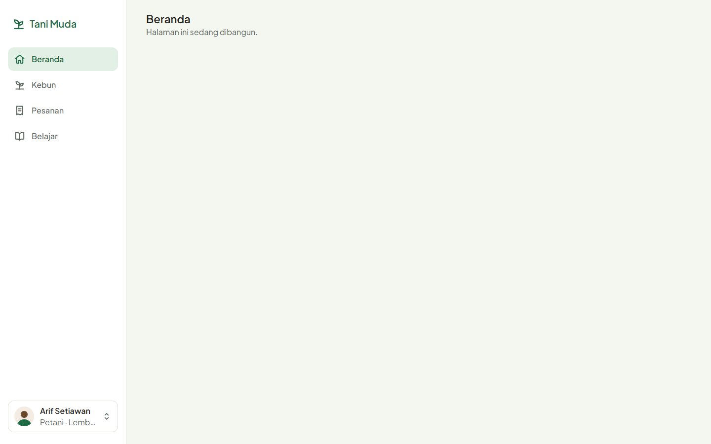
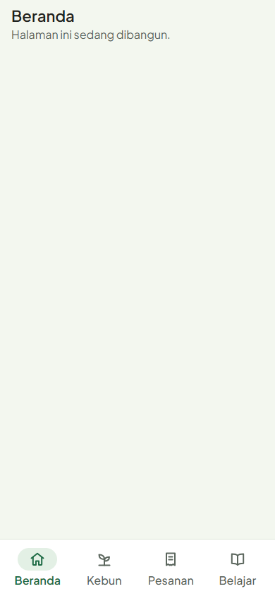
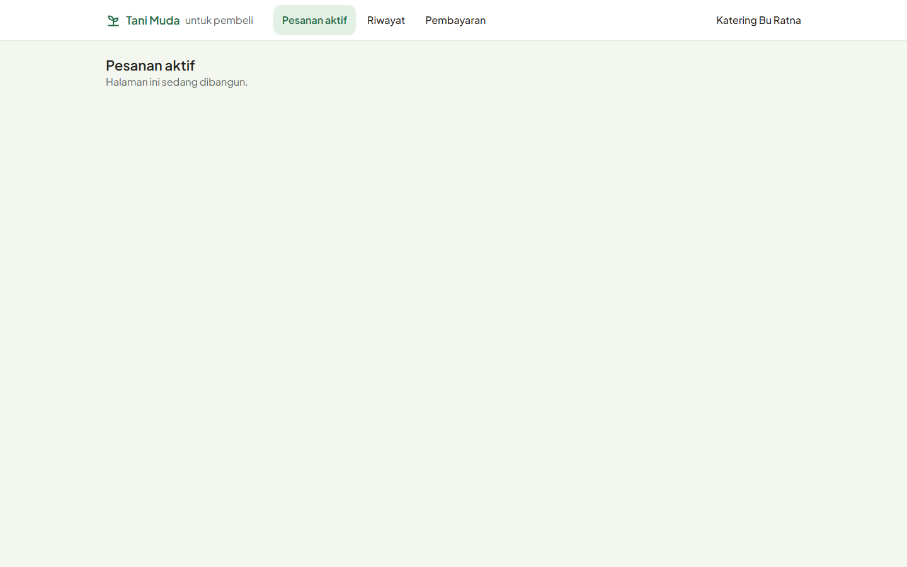

# Tani Muda

Tani Muda adalah aplikasi web responsif (PWA) yang menemani petani muda melewati satu siklus tanam: belajar cara menanam, menghitung modal, merawat tanaman dengan pengingat, sampai menjual panen langsung ke pembeli sebelum menanam. Semua fitur bertumpu pada **Resep Tanam**, yaitu panduan per komoditas dan metode tanam yang divalidasi penyuluh.

Aplikasi ini dirancang untuk HP di lahan, di bawah matahari, dengan sinyal lemah. Karena itu teksnya paling kecil 16px, target sentuh paling kecil 48px, dan aplikasi tetap bisa dipakai saat offline.

> **Status:** v1 untuk lomba dan pilot di satu kecamatan. Tahap 1 (fondasi: sistem desain, komponen, kerangka halaman) sudah selesai. Rincian progres ada di [`docs/rencana-kerja.md`](docs/rencana-kerja.md).

## Fitur utama

| Pilar       | Fitur                                                                                                                                                 | Hasil bagi petani muda                  |
| ----------- | ----------------------------------------------------------------------------------------------------------------------------------------------------- | --------------------------------------- |
| **Belajar** | Modul video singkat per tahap tanam, daftar tugas harian                                                                                              | Tahu cara menanam yang benar            |
| **Hitung**  | Kalkulator modal dari resep (benih, pupuk, harga, biaya lain, titik impas), jadwal perawatan otomatis dengan pengingat, catatan pengeluaran           | Modal terukur dan perawatan tepat waktu |
| **Jual**    | Pesan Sebelum Tanam: pembeli memasang pesanan, petani di sekitar mengambilnya, uang muka ditahan dengan aman, pembayaran per kiriman, rating dua arah | Pembeli dan harga pasti sebelum menanam |

## Tangkapan layar

Halaman komponen `/komponen` dibandingkan berdampingan dengan papan sistem desain:

| Desktop 1440px                                                                                                 | Mobile 390px                                                                                             |
| -------------------------------------------------------------------------------------------------------------- | -------------------------------------------------------------------------------------------------------- |
|  |  |

Kerangka halaman: sidebar untuk petani di desktop dan navigasi bawah di HP.

| Petani, desktop                                                                                                         | Petani, mobile                                                                                                    | Pembeli, desktop                                                                                                          |
| ----------------------------------------------------------------------------------------------------------------------- | ----------------------------------------------------------------------------------------------------------------- | ------------------------------------------------------------------------------------------------------------------------- |
|  |  |  |

Semua tangkapan ada di [`docs/tangkapan/`](docs/tangkapan/). Penamaannya mengikuti indeks papan di [`design/README.md`](design/README.md).

## Stack

| Bagian          | Teknologi                                                                  |
| --------------- | -------------------------------------------------------------------------- |
| Antarmuka       | React 19, TypeScript (strict), Vite, vite-plugin-pwa                       |
| Tampilan        | Tailwind CSS 3.4 dengan token dari sistem desain (tema bawaan diganti)     |
| Data dan server | Supabase: PostgreSQL + PostGIS, Auth OTP nomor HP, Storage, Edge Functions |
| Offline         | Dexie (IndexedDB) dan TanStack Query                                       |
| Pengujian       | Vitest (fungsi murni di Node, komponen di jsdom), Testing Library          |
| Mutu            | ESLint, Prettier, pemeriksa aturan proyek (`scripts/cek-aturan.mjs`)       |

## Menjalankan

Kebutuhan: Node.js 24 dan npm.

```bash
npm install
cp .env.example .env    # isi nilainya; jangan commit .env
npm run dev             # http://localhost:5173
```

| Perintah                                 | Fungsi                                                                                                                   |
| ---------------------------------------- | ------------------------------------------------------------------------------------------------------------------------ |
| `npm run dev`                            | Server pengembangan                                                                                                      |
| `npm test`                               | Semua tes                                                                                                                |
| `npm run test:cakupan`                   | Tes dan cakupan `src/lib` (ambang 90%)                                                                                   |
| `npm run lint`                           | ESLint dan pemeriksa aturan proyek (warna di luar token, teks di bawah 16px, bayangan, kata terlarang, service role key) |
| `npm run typecheck`                      | Cek tipe TypeScript                                                                                                      |
| `npm run build`                          | Cek tipe dan build produksi ke `dist/`                                                                                   |
| `npm run ekstrak-desain`                 | Bongkar file desain ke `design/extracted/` (bahan kerja, tidak masuk git)                                                |
| `npm run tangkap -- <url> <jalur-dasar>` | Tangkapan layar 390px dan 1440px dengan Chrome atau Edge yang terpasang                                                  |

## Struktur folder

```
tani-muda/
├── design/                 sumber desain (tidak diubah)
│   ├── desain-tani-muda.html   file desain asli: sistem desain + semua halaman
│   ├── icons/                  16 ikon resmi
│   └── README.md               indeks papan desain
├── docs/
│   ├── keputusan.md        keputusan produk; mengalahkan PRD dan desain
│   ├── aturan-proyek.md    aturan wajib di setiap tugas
│   ├── rencana-kerja.md    tahap, tugas, dan progres
│   ├── ringkasan-desain.md token, komponen, dan daftar halaman
│   ├── cek-komponen.md     hasil perbandingan komponen dengan desain
│   ├── prd-tani-muda.md    kebutuhan produk (PRD)
│   └── tangkapan/          tangkapan layar aplikasi dan desain
├── public/fonts/           Plus Jakarta Sans (lokal)
├── scripts/                pemeriksa aturan, ekstraksi desain, tangkapan layar
└── src/
    ├── lib/                fungsi murni dan tesnya (format, tata letak penggaris, ...)
    ├── teks/               semua teks antarmuka (Bahasa Indonesia)
    ├── komponen/           komponen bersama (tombol, kartu, penggaris umur tanam, ...)
    ├── halaman/            halaman
    ├── uji/                persiapan tes
    ├── rute.tsx            daftar rute
    └── main.tsx            titik masuk
```

Folder yang akan ditambahkan di tahap berikutnya: `src/data/` (akses Supabase dan antrean offline), `src/penyedia/` (antarmuka pembayaran dan OTP), `src/tipe/`, dan `supabase/` (migrasi, seed, Edge Functions).

## Dokumen penting

Baca berurutan sebelum mengerjakan tugas:

1. [`docs/keputusan.md`](docs/keputusan.md): keputusan produk; **mengalahkan PRD dan desain**.
2. [`docs/aturan-proyek.md`](docs/aturan-proyek.md): aturan wajib di setiap tugas.
3. [`docs/rencana-kerja.md`](docs/rencana-kerja.md): daftar tugas dan progres.
4. [`docs/ringkasan-desain.md`](docs/ringkasan-desain.md): token, komponen, dan halaman.

## Keamanan

- Hanya variabel berawalan `VITE_` yang sampai ke browser, dan semuanya terbuka untuk publik.
- Service role key Supabase, kunci payment gateway, dan kunci VAPID privat hanya disimpan sebagai rahasia Edge Function, tidak pernah di frontend.
- Hak akses data dijaga Row Level Security di basis data.
- `npm run lint` gagal bila ada pola service role di `src/`.

## Data contoh

Angka dosis, harga, hasil panen, dan rentang pH/PPM di repositori ini adalah **data contoh** yang belum divalidasi penyuluh. Di aplikasi, angka itu selalu berlabel "CONTOH, belum divalidasi penyuluh" dan tidak boleh dibaca sebagai rekomendasi agronomis atau keuangan.

## Lisensi pihak ketiga

Font Plus Jakarta Sans (SIL Open Font License 1.1) disalin dari file desain ke `public/fonts/`.
