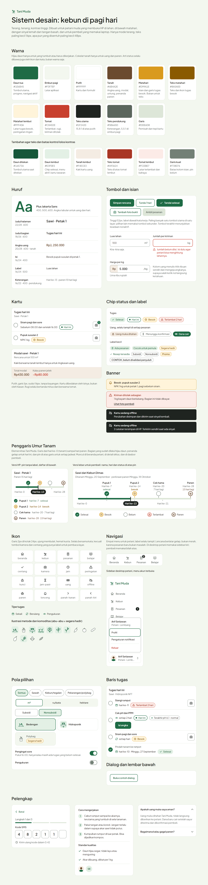
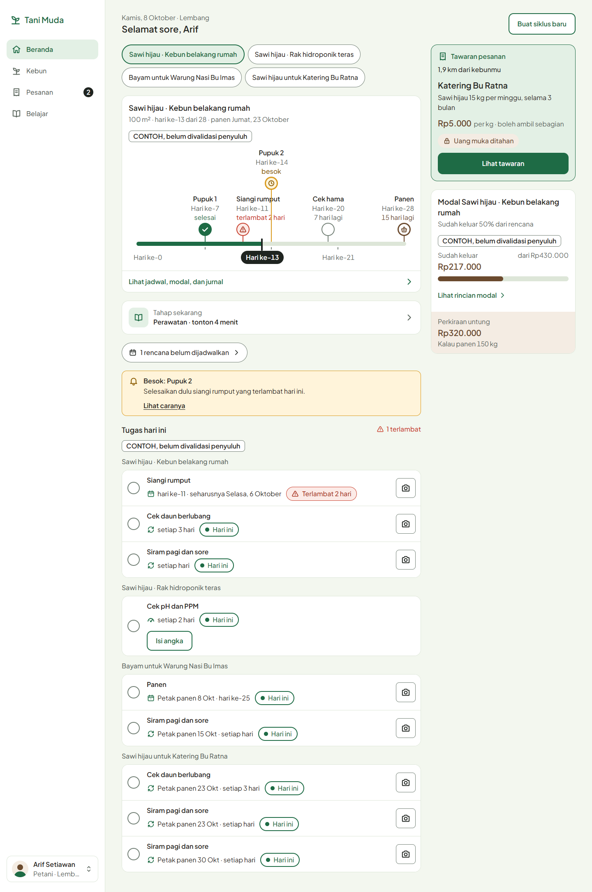
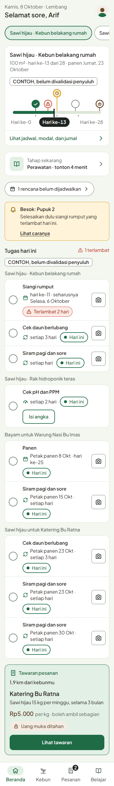
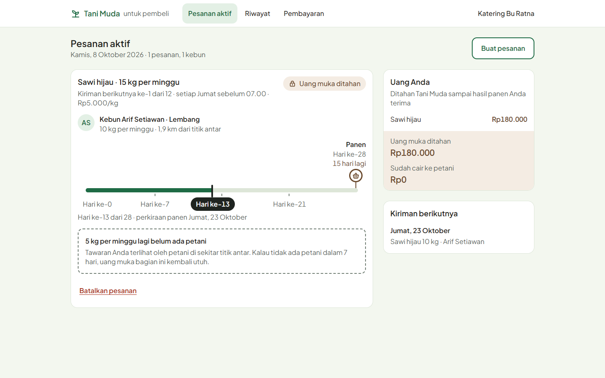

# Tani Muda

Tani Muda adalah aplikasi web responsif (PWA) yang menemani petani muda melewati satu siklus tanam: belajar cara menanam, menghitung modal, merawat tanaman dengan pengingat, sampai menjual panen langsung ke pembeli sebelum menanam. Semua fitur bertumpu pada **Resep Tanam**, yaitu panduan per komoditas dan metode tanam yang divalidasi penyuluh.

Aplikasi ini dirancang untuk HP di lahan, di bawah matahari, dengan sinyal lemah. Karena itu teksnya paling kecil 16px, target sentuh paling kecil 48px, dan aplikasi tetap bisa dipakai saat offline.

> **Status:** v1 untuk lomba dan pilot di satu kecamatan. Tahap 1 (fondasi: sistem desain, komponen, kerangka halaman) sudah selesai. Tampilan dikerjakan lebih dulu dengan data tiruan; backend Laravel menyusul setelah semua halaman selesai. Rincian progres ada di [`docs/rencana-kerja.md`](docs/rencana-kerja.md).

## Fitur utama

| Pilar       | Fitur                                                                                                                                                 | Hasil bagi petani muda                  |
| ----------- | ----------------------------------------------------------------------------------------------------------------------------------------------------- | --------------------------------------- |
| **Belajar** | Modul video singkat per tahap tanam, daftar tugas harian                                                                                              | Tahu cara menanam yang benar            |
| **Hitung**  | Kalkulator modal dari resep (benih, pupuk, harga, biaya lain, titik impas), jadwal perawatan otomatis dengan pengingat, catatan pengeluaran           | Modal terukur dan perawatan tepat waktu |
| **Jual**    | Pesan Sebelum Tanam: pembeli memasang pesanan, petani di sekitar mengambilnya, uang muka ditahan dengan aman, pembayaran per kiriman, rating dua arah | Pembeli dan harga pasti sebelum menanam |

## Tangkapan layar

Halaman komponen `/komponen` dibandingkan berdampingan dengan papan sistem desain:

| Desktop 1440px                                                                                                 | Mobile 390px                                                                                             |
| -------------------------------------------------------------------------------------------------------------- | -------------------------------------------------------------------------------------------------------- |
|  |  |

Halaman yang sudah jadi: Beranda petani dan dasbor pembeli.

| Petani, desktop                                                                                               | Petani, mobile                                                                                          | Pembeli, desktop                                                                                                              |
| ------------------------------------------------------------------------------------------------------------- | ------------------------------------------------------------------------------------------------------- | ----------------------------------------------------------------------------------------------------------------------------- |
|  |  |  |

Semua tangkapan ada di [`docs/tangkapan/`](docs/tangkapan/); tangkapan kerangka Tahap 1 disimpan di [`docs/tangkapan/arsip/tahap-1/`](docs/tangkapan/arsip/tahap-1/). Penamaannya mengikuti indeks papan di [`design/README.md`](design/README.md).

## Stack

| Bagian            | Teknologi                                                                                                          |
| ----------------- | ------------------------------------------------------------------------------------------------------------------ |
| Antarmuka         | React 19, TypeScript (strict), Vite, vite-plugin-pwa                                                               |
| Tampilan          | Tailwind CSS 3.4 dengan token dari sistem desain (tema bawaan diganti)                                             |
| Data (sekarang)   | Klien API dengan implementasi tiruan berisi data contoh (memori dan localStorage)                                  |
| Backend (Tahap 5) | Laravel 13 (PHP 8.3+), Sanctum (login nomor HP + OTP), Pest, MySQL/MariaDB dari XAMPP, berjalan lokal tanpa Docker |
| Offline           | Dexie (IndexedDB) dan TanStack Query                                                                               |
| Pengujian         | Vitest (fungsi murni di Node, komponen di jsdom), Testing Library                                                  |
| Mutu              | ESLint, Prettier, pemeriksa aturan proyek (`scripts/cek-aturan.mjs`)                                               |

## Menjalankan

Kebutuhan: Node.js 24 dan npm.

```bash
npm install
cp .env.example .env    # isi nilainya; jangan commit .env
npm run dev             # http://localhost:5173
```

| Perintah                                 | Fungsi                                                                                                                  |
| ---------------------------------------- | ----------------------------------------------------------------------------------------------------------------------- |
| `npm run dev`                            | Server pengembangan                                                                                                     |
| `npm run demo`                           | Server pengembangan dengan pengaturan demo (data tiruan, resep contoh)                                                  |
| `npm test`                               | Semua tes                                                                                                               |
| `npm run test:cakupan`                   | Tes dan cakupan `src/lib` (ambang 90%)                                                                                  |
| `npm run lint`                           | ESLint dan pemeriksa aturan proyek (warna di luar token, teks di bawah 16px, bayangan, kata terlarang, rahasia backend) |
| `npm run typecheck`                      | Cek tipe TypeScript                                                                                                     |
| `npm run build`                          | Cek tipe dan build produksi ke `dist/`                                                                                  |
| `npm run ekstrak-desain`                 | Bongkar file desain ke `design/extracted/` (bahan kerja, tidak masuk git)                                               |
| `npm run tangkap -- <url> <jalur-dasar>` | Tangkapan layar 390px dan 1440px dengan Chrome atau Edge yang terpasang                                                 |
| `npm run data-contoh`                    | Tulis ulang `src/api/tiruan/data/*.json` dari `pembuat-data.ts`                                                         |
| `npm run pasang-video`                   | Pasang video modul asli dari `public/video/modul/` (lihat "Memasang video modul")                                       |
| `node scripts/buat-ikon.mjs`             | Buat ulang favicon dan ikon layar utama di `public/` dari ikon kebun dan token warna                                    |

Sumber data dipilih dengan `VITE_SUMBER_DATA` di `.env`: `tiruan` (bawaan, data contoh di browser) atau `http` (backend Laravel, tersedia mulai Tahap 6). Data tiruan yang diubah selama demo tersimpan di `localStorage` browser.

### Menjalankan demo

```bash
npm run demo            # http://localhost:5173, semua pengaturan demo menyala
```

`npm run demo` menjalankan mode pengembangan dengan data tiruan dan resep contoh tampil, tanpa bergantung pada isi `.env` (D-37). Lalu:

1. Buka `/akun-demo` dan pilih pengguna uji (petani, pembeli, penyuluh, admin) tanpa kode SMS.
2. Atau buka `/masuk`: kode OTP uji tampil di kotak "Mode pengembangan".
3. Tombol **Atur ulang data demo** di `/akun-demo` mengembalikan semua data ke data contoh awal.

Dengan `npm run dev`, resep contoh hanya tampil bila `.env` berisi `VITE_TAMPILKAN_RESEP_CONTOH=true` (D-12). Pemilih akun demo dan kode uji tidak pernah ikut `npm run build` (dicek otomatis). Cadangan demo lokal (T6.09, D-48), tanpa server pengembangan:

```bash
npm run build:demo      # build dengan data tiruan, pemilih akun demo, dan label "Mode demo" ke dist-demo/
npm run preview:demo    # http://localhost:4173
```

Peramban yang belum punya data langsung disiapkan data demo; **Atur ulang data demo** ada di `/akun-demo` (juga lewat label "Mode demo"). Build produksi biasa (`npm run build`) tetap tanpa akun demo dan label demo.

### Memasang video modul

Video asli modul belajar (MP4 360p, D-29) dipasang tanpa mengubah kode:

1. Ekspor video sebagai **MP4 (H.264) 360p**, paling besar **15 MB** (`batas_video_mb` di konfigurasi). Durasi sekitar 3 menit.
2. Beri nama berkas **sama dengan id modulnya**, lalu taruh di `public/video/modul/`. Contoh: `modul-sawi-bedengan-4.mp4` untuk modul Perawatan sawi bedengan. Id setiap modul ada di `src/api/tiruan/data/modul.json` (kolom `id`) dan tampil di alamat halaman pemutar (`/belajar/<id>`).
3. Jalankan:

   ```bash
   npm run pasang-video
   ```

   Skrip memeriksa nama, format, dan ukuran, lalu menulis `src/api/tiruan/data/video-modul.json` (nama berkas dan ukurannya). Berkas yang salah nama, bukan MP4, atau terlalu besar disebutkan satu per satu dan tidak dipasang.

4. Muat ulang aplikasi. Modul itu langsung memakai video asli menggantikan video contoh atau keterangan "video sedang disiapkan"; data demo tidak perlu diatur ulang.
5. Commit berkas video dan `video-modul.json` bersama-sama. `npm test` gagal bila daftar menunjuk berkas yang tidak ada.

Untuk mencopot video, hapus berkasnya lalu jalankan `npm run pasang-video` lagi. Di Tahap 5, seeder backend membaca `video-modul.json` yang sama.

## Struktur folder

```
tani-muda/
├── design/                 sumber desain (tidak diubah)
│   ├── desain-tani-muda.html   file desain asli: sistem desain + semua halaman
│   ├── icons/                  16 ikon resmi
│   └── README.md               indeks papan desain
├── docs/
│   ├── keputusan.md        keputusan produk; mengalahkan PRD dan desain
│   ├── kontrak-api.md      bentuk data dan endpoint frontend ↔ backend
│   ├── arsitektur-backend.md rancangan backend Laravel
│   ├── aturan-proyek.md    aturan wajib di setiap tugas
│   ├── rencana-kerja.md    tahap, tugas, dan progres
│   ├── ringkasan-desain.md token, komponen, dan daftar halaman
│   ├── cek-komponen.md     hasil perbandingan komponen dengan desain
│   ├── prd-tani-muda.md    kebutuhan produk (PRD)
│   └── tangkapan/          tangkapan layar aplikasi dan desain
├── public/fonts/           Plus Jakarta Sans (lokal)
├── scripts/                pemeriksa aturan, ekstraksi desain, tangkapan layar
└── src/
    ├── lib/                fungsi murni dan tesnya (format, hitungan modal, jadwal, ...)
    ├── tipe/               tipe domain (camelCase)
    ├── api/                kontrak (tipe snake_case), klien API, hook kueri, klien tiruan + data contoh
    ├── penyedia/           antarmuka OTP dan pembayaran beserta implementasi tiruannya
    ├── teks/               semua teks antarmuka (Bahasa Indonesia)
    ├── komponen/           komponen bersama (tombol, kartu, penggaris umur tanam, ...)
    ├── halaman/            halaman
    ├── uji/                persiapan tes
    ├── rute.tsx            daftar rute
    └── main.tsx            titik masuk
```

Halaman dan komponen hanya mengambil data lewat hook di `src/api/kueri` (dijaga lint). Di Tahap 5 repositori dipecah menjadi `frontend/` (proyek React ini), `backend/` (Laravel), dan `shared/kasus-uji/` (kasus uji perhitungan yang dipakai Vitest dan Pest). Rancangannya di [`docs/arsitektur-backend.md`](docs/arsitektur-backend.md).

## Dokumen penting

Baca berurutan sebelum mengerjakan tugas:

1. [`docs/keputusan.md`](docs/keputusan.md): keputusan produk; **mengalahkan PRD dan desain**.
2. [`docs/aturan-proyek.md`](docs/aturan-proyek.md): aturan wajib di setiap tugas.
3. [`docs/rencana-kerja.md`](docs/rencana-kerja.md): daftar tugas dan progres.
4. [`docs/ringkasan-desain.md`](docs/ringkasan-desain.md): token, komponen, dan halaman.
5. [`docs/kontrak-api.md`](docs/kontrak-api.md): bentuk data dan endpoint API.
6. [`docs/arsitektur-backend.md`](docs/arsitektur-backend.md): rancangan backend Laravel.

## Keamanan

- Hanya variabel berawalan `VITE_` yang sampai ke browser, dan semuanya terbuka untuk publik.
- Kunci rahasia (`APP_KEY`, kata sandi basis data, kunci VAPID privat, kunci pembayaran) hanya ada di file `.env` backend dan tidak pernah dikirim ke frontend.
- Hak akses data dijaga di server lewat Policy per peran. Klien API tiruan menegakkan aturan yang sama selama backend belum ada.
- `npm run lint` gagal bila kode frontend atau `.env.example` menyebut nama kunci rahasia backend atau variabel selain `VITE_*`.

## Data contoh

Angka dosis, harga, hasil panen, dan rentang pH/PPM di repositori ini adalah **data contoh** yang belum divalidasi penyuluh. Di aplikasi, angka itu selalu berlabel "CONTOH, belum divalidasi penyuluh" dan tidak boleh dibaca sebagai rekomendasi agronomis atau keuangan.

## Lisensi pihak ketiga

Font Plus Jakarta Sans (SIL Open Font License 1.1) disalin dari file desain ke `public/fonts/`.
